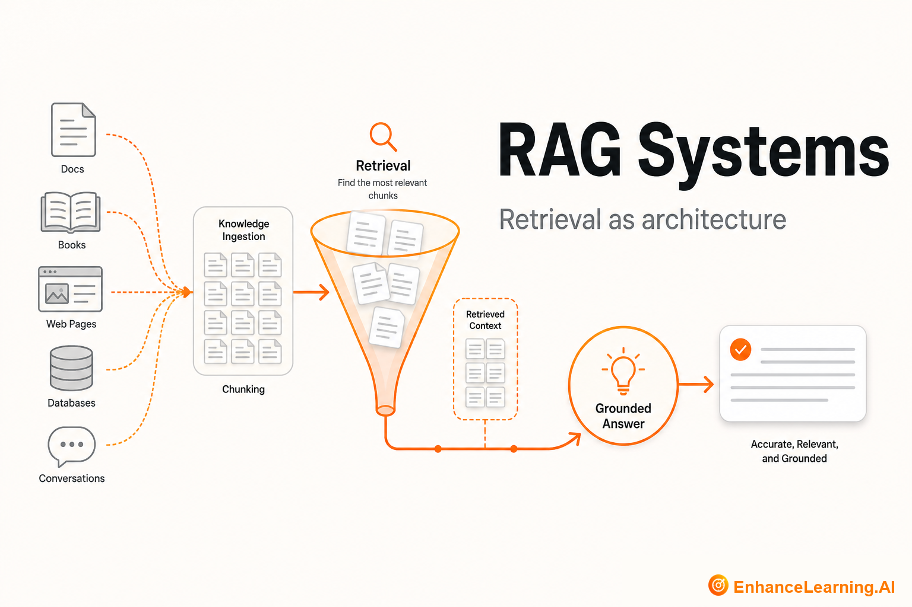

  

# RAG Systems: Making Retrieval a First-Class Architecture Pattern

> Maintained reading path from [EnhanceLearning.AI](https://enhancelearning.ai) — practitioner-grade articles for engineers, architects, and technology leaders building production AI-native systems.

**Topic on the site:** [RAG Systems](https://enhancelearning.ai/articles?category=RAG+Systems) · **Full library:** [enhancelearning.ai/articles](https://enhancelearning.ai/articles)

## What this repo is

A curated reading path for **RAG Systems**. It is not a code SDK — it points to the foundation deep-dives on [EnhanceLearning.AI](https://enhancelearning.ai) so you can align on concepts, critique designs, and ship production systems that hold up.

This topic covers what RAG actually solves, why production RAG breaks, vector similarity vs relevance, retrieval-only vs retrieval-augmented designs, and how to treat RAG as architecture — not a feature flag.

## Who it's for

Engineers building knowledge assistants, search-plus-generation products, and enterprise Q&A systems.

## Foundation articles

- [What Retrieval-Augmented Generation Solves in AI-Native Systems](https://enhancelearning.ai/articles/what-retrieval-augmented-generation-solves-in-ai-native-systems) — Why RAG exists: parametric model knowledge is stale and incomplete. Where retrieval sits in the AI-native stack and what problems it actually fixes.
- [Why RAG is a First-Class Architecture Pattern, Not a Feature Flag](https://enhancelearning.ai/articles/why-rag-is-a-first-class-architecture-pattern-not-a-feature-flag) — RAG is a structural design choice — indexing, retrieval contracts, and grounding — not an optional chatbot toggle you enable after launch.
- [The Difference Between Retrieval-Augmented and Retrieval-Only Systems](https://enhancelearning.ai/articles/difference-between-retrieval-augmented-and-retrieval-only-systems) — Search that returns documents is not RAG. How retrieval-only systems differ from retrieval-augmented generation — and why conflating them breaks design.
- [The Anatomy of a Production-Ready RAG Pipeline](https://enhancelearning.ai/articles/the-anatomy-of-a-production-ready-rag-pipeline) — End-to-end RAG reference architecture: ingestion through chunking, indexing, retrieval, reranking, context assembly, generation, citation, and eval.
- [Why Vector Similarity isn't the Same as Relevance in RAG](https://enhancelearning.ai/articles/why-vector-similarity-isnt-the-same-as-relevance-in-rag) — Cosine similarity measures embedding neighborhood, not user-meaningful relevance. Why RAG quality degrades silently when teams treat them as identical.
- [Why most RAG Systems Fail in Production](https://enhancelearning.ai/articles/why-most-rag-systems-fail-in-production) — Where production RAG breaks: chunking mistakes, retrieval that looks fine in demos, missing reranking, and evaluation that never measures answer faithfulness.

## More from EnhanceLearning.AI

- Homepage: [https://enhancelearning.ai](https://enhancelearning.ai)
- All articles: [https://enhancelearning.ai/articles](https://enhancelearning.ai/articles)
- This topic filter: [RAG Systems](https://enhancelearning.ai/articles?category=RAG+Systems)
